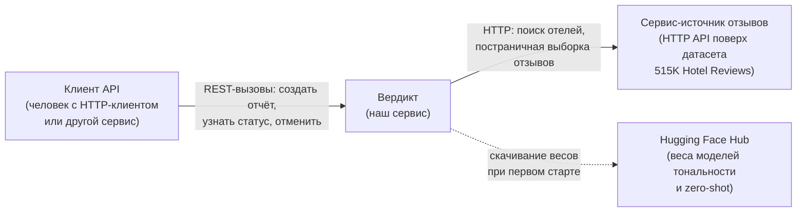
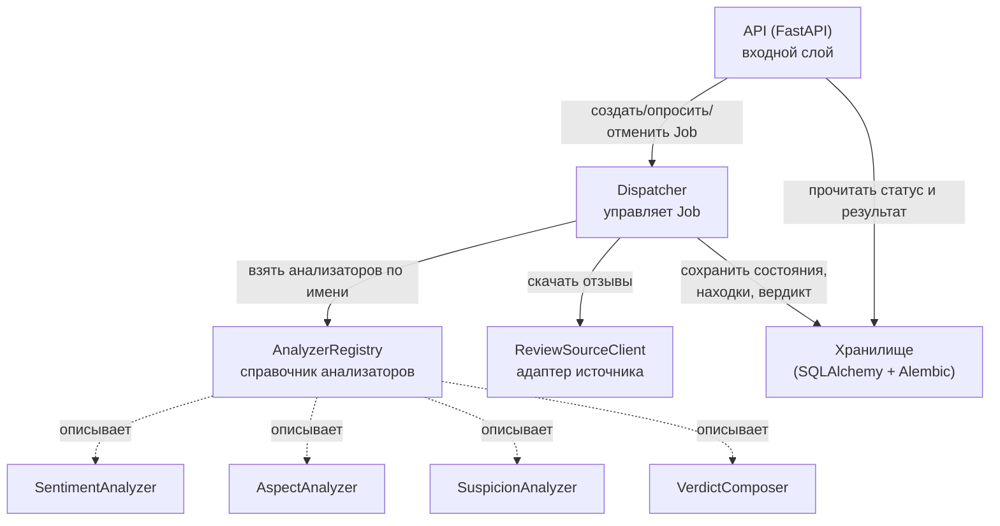
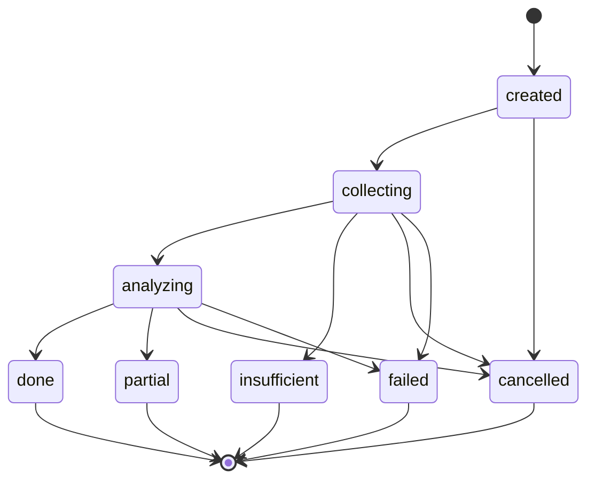

# Архитектура: Вердикт

## Контекст (C4, уровень 1)

Стрелки здесь — вызовы между людьми/системами и нашей системой. Пунктир к Hugging Face —
разовое скачивание весов при старте контейнера, в работе сервиса этого вызова нет.

Система принимает запрос на разбор отзывов, выполняет его в фоне и отдаёт
вердикт; устройство источника, моделей и хранилища от клиента скрыто.

## Компоненты (C4, уровень 2)

Сплошные стрелки — вызовы кода, пунктирные — чтение описаний из справочника.
Dispatcher знает только интерфейс `Analyzer` и идёт за исполнителями в Registry,
конкретные классы анализаторов ему неизвестны.

| Компонент | Отвечает за | Скрывает от соседей |
|---|---|---|
| API (FastAPI) | приём HTTP, валидация параметров, идемпотентность, формат ошибок | что происходит внутри Job: Dispatcher, анализаторы, БД |
| Dispatcher | жизненный цикл Job, порядок этапов, решение о `done/partial/insufficient/failed` | как устроен HTTP-слой и как анализаторы считают результат |
| AnalyzerRegistry | список доступных анализаторов, выбор по имени | как анализатор реализован внутри |
| Анализаторы (Sentiment, Aspect, Suspicion) | превращают отзывы в находки: тональность, аспект, подозрительность | модель, пороги и правила; наружу только `AnalyzerResult` |
| VerdictComposer | агрегация находок в вердикт с затуханием по времени | как считаются отдельные находки |
| ReviewSourceClient | HTTP-общение с источником: пагинация, timeout, retry, разбор мусора | реальный адрес источника и его капризы |
| Хранилище | справочник организаций, Job, история переходов, находки, ключи идемпотентности | схему БД и диалект (SQLite/PostgreSQL) |

## Диаграмма состояний Job

Разрешённые переходы и их причины:

- `created → collecting` — Job взят в работу;
- `collecting → analyzing` — отзывы собраны, хватает для вердикта;
- `collecting → insufficient` — отзывов меньше `MIN_REVIEWS`, вердикт не строим;
- `collecting → failed` — источник недоступен целиком после повторов;
- `analyzing → done` — все анализаторы отработали;
- `analyzing → partial` — часть страниц не собралась, вердикт построен на собранном
  с пометкой о доле пропущенного;
- `analyzing → failed` — ошибка внутри сервиса (модель, данные);
- отмена `cancelled` доступна из `created`, `collecting`, `analyzing`.

Запрещённые переходы. Любой переход из конечного состояния (`done`, `partial`,
`insufficient`, `failed`, `cancelled`), включая повторную отмену и перезапуск
`done → analyzing`, отклоняется ошибкой `invalid_transition`: HTTP 409, тело
`{"code": "invalid_transition", "message": ..., "details": {"from": "...", "to": "..."}}`.
Текущее состояние Job при этом не меняется. «Воскресить» отчёт нельзя — клиент
создаёт новый Job тем же запросом; идемпотентность на повтор с тем же ключом
возвращает прежний отчёт (см. ADR-0002 и `contract-check.md`, К1 и К5).
